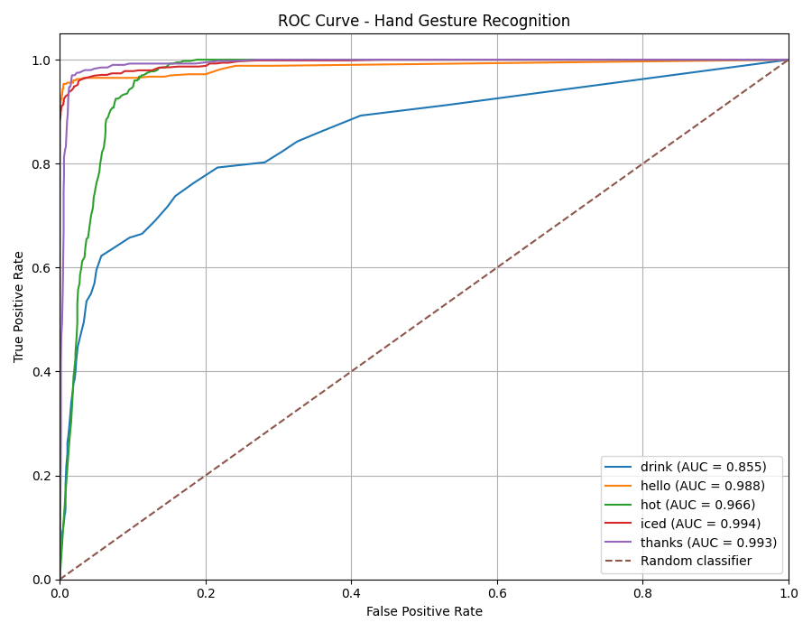
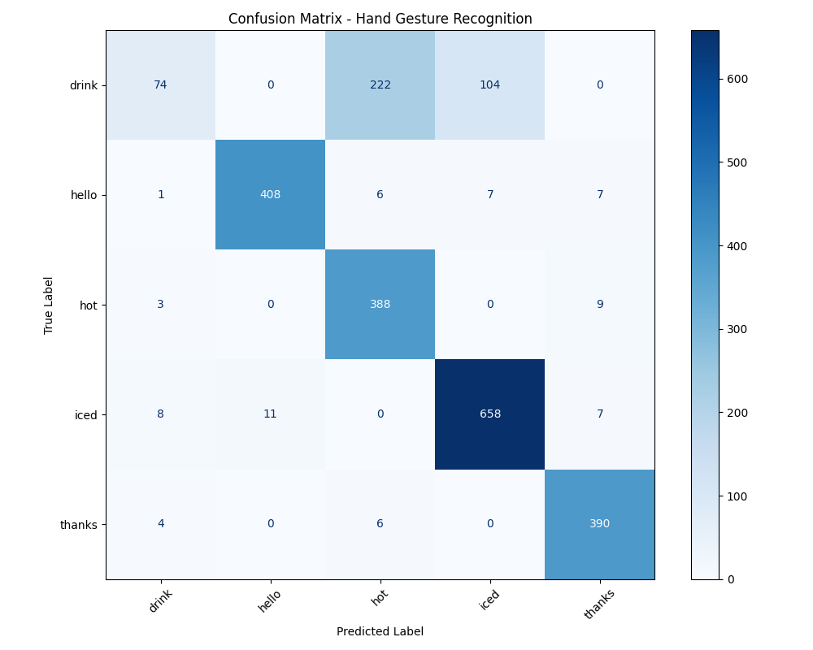

# SignMachine

> A real-time hand gesture recognition application designed to support communication for people with hearing and speech impairments.

> Ứng dụng nhận diện cử chỉ tay theo thời gian thực, được phát triển nhằm hỗ trợ giao tiếp cho người khiếm thính và khiếm ngôn.

---

## ✨ Features | Tính năng

* 🎥 **Real-time webcam hand gesture recognition**
  **Nhận diện cử chỉ tay theo thời gian thực** thông qua webcam.

* ✋ **Hand landmark detection using MediaPipe**
  **Phát hiện các điểm đặc trưng của bàn tay** bằng MediaPipe.

* 🤖 **Machine learning-based gesture classification**
  **Phân loại cử chỉ bằng mô hình Machine Learning**.

* 🖥️ **Desktop GUI built with Tkinter**
  **Giao diện ứng dụng desktop** được xây dựng bằng Tkinter.

* 📊 **Hand-landmark dataset processing**
  **Xử lý dữ liệu landmark của bàn tay** phục vụ huấn luyện mô hình.

* ⚡ **Fast real-time response**
  **Tối ưu khả năng phản hồi nhanh** trong quá trình nhận diện.

---

## 🏗️ Project Structure | Cấu trúc dự án

```text
SignMachine/
│
├── hand_gesture_app.py
├── collect_data_from_images.py
├── preprocess_*.py
├── requirements.txt
│
├── models/
│   └── hand_gesture_model_*.pkl
│
├── data/
│   └── processed_hand_data.csv
│
├── lang/
│   └── lang_mana.py
│
└── README.md
```

> The exact files may change as the project is developed.
> Các file cụ thể có thể thay đổi trong quá trình phát triển dự án.

---

## ⚙️ System Requirements | Yêu cầu hệ thống

| Requirement / Yêu cầu                   | Version / Phiên bản |
| --------------------------------------- | ------------------- |
| Python                                  | **3.12.5**          |
| Operating System / Hệ điều hành         | Windows             |
| Webcam / Camera                         | Required / Bắt buộc |
| Package manager / Trình quản lý package | pip                 |

All required Python packages are listed in `requirements.txt`.

Tất cả các thư viện Python cần thiết được liệt kê trong file `requirements.txt`.

---

## 🚀 Installation | Cài đặt

### 1. Clone the repository | Clone repository

```bash
git clone https://github.com/winac2/signlang_test.git
cd folder
```

---

### 2. Check Python version | Kiểm tra phiên bản Python

Make sure Python **3.12.5** is installed.

Đảm bảo máy tính đã cài đặt **Python 3.12.5**.

```bash
python --version
```

Expected output / Kết quả mong đợi:

```text
Python 3.12.5
```

---

### 3. Upgrade pip | Cập nhật pip

```bash
python.exe -m pip install --upgrade pip
```

---

### 4. Install dependencies | Cài đặt thư viện

```bash
python -m pip install -r requirements.txt
```

---

## ▶️ Run the Application | Chạy ứng dụng

After installing all dependencies, run:

Sau khi cài đặt đầy đủ các thư viện, chạy:

```bash
python hand_gesture_app.py
```

The application will start and access the computer's webcam for real-time hand gesture recognition.

Ứng dụng sẽ khởi động và sử dụng webcam để nhận diện cử chỉ tay theo thời gian thực.

---

## 🧠 How It Works | Cách hoạt động

The main recognition pipeline is:

Quy trình nhận diện chính:

```text
Webcam
   │
   ▼
Video Frame
Khung hình
   │
   ▼
MediaPipe Hand Detection
Phát hiện bàn tay
   │
   ▼
21 Hand Landmarks
21 điểm đặc trưng của bàn tay
   │
   ▼
Feature Processing
Xử lý đặc trưng
   │
   ▼
Trained ML Model
Mô hình Machine Learning
   │
   ▼
Recognized Gesture
Cử chỉ được nhận diện
   │
   ▼
Application Output
Kết quả trên ứng dụng
```

Each detected hand contains **21 landmarks**.

Mỗi bàn tay được phát hiện gồm **21 điểm landmark**.

Each landmark contains:

Mỗi landmark bao gồm:

```text
X coordinate
Y coordinate
Z coordinate
```

These coordinates are used as input features for the machine learning model.

Các tọa độ này được sử dụng làm **đặc trưng đầu vào** cho mô hình Machine Learning.

---

## 📊 Data Processing | Xử lý dữ liệu

SignMachine uses hand-landmark data instead of directly using raw images as input to the classifier.

SignMachine sử dụng dữ liệu **hand landmark** thay vì đưa trực tiếp ảnh thô vào mô hình phân loại.

The general data pipeline is:

Quy trình xử lý dữ liệu:

```text
Images / Webcam Data
Ảnh / Dữ liệu từ webcam
        │
        ▼
Hand Landmark Extraction
Trích xuất landmark bàn tay
        │
        ▼
Data Cleaning
Làm sạch dữ liệu
        │
        ▼
Preprocessing
Tiền xử lý
        │
        ▼
Training Dataset
Dữ liệu huấn luyện
        │
        ▼
Machine Learning Model
Mô hình Machine Learning
```

The processed data are stored in CSV format and contain the gesture label together with the extracted hand landmark features.

Dữ liệu sau xử lý được lưu dưới dạng CSV, bao gồm **nhãn cử chỉ** và các **đặc trưng landmark** được trích xuất từ bàn tay.

---

## 🤖 Machine Learning | Machine Learning

SignMachine uses a trained machine learning classifier to recognize predefined hand gestures.

SignMachine sử dụng mô hình Machine Learning đã được huấn luyện để nhận diện các cử chỉ tay được định nghĩa trong dataset.

The trained model is saved as a `.pkl` file and loaded by the application during runtime.

Mô hình sau khi huấn luyện được lưu dưới dạng file `.pkl` và được ứng dụng tải lên khi chạy.

Example / Ví dụ:

```text
models/
└── hand_gesture_model_*.pkl
```

The model receives processed hand-landmark coordinates as input and returns the predicted gesture.

Mô hình nhận các tọa độ landmark đã được xử lý làm đầu vào và trả về cử chỉ được dự đoán.
---

## Model evaluate | Đánh giá mô hình
The Random Forest model was evaluated on 2,313 samples with 42 input features across five gesture classes.

Mô hình Random Forest được đánh giá trên 2.313 mẫu dữ liệu với 42 đặc trưng đầu vào, thuộc 5 lớp cử chỉ: drink, hello, hot, iced và thanks.
### ROC-AUC

| Class | AUC |
|---|---:|
| `drink` | 0.8552 |
| `hello` | 0.9875 |
| `hot` | 0.9660 |
| `iced` | 0.9940 |
| `thanks` | 0.9934 |

### Confusion Matrix

| Actual \ Predicted | drink | hello | hot | iced | thanks |
|---|---:|---:|---:|---:|---:|
| `drink` | 74 | 0 | 222 | 104 | 0 |
| `hello` | 1 | 408 | 6 | 7 | 7 |
| `hot` | 3 | 0 | 388 | 0 | 9 |
| `iced` | 8 | 11 | 0 | 658 | 7 |
| `thanks` | 4 | 0 | 6 | 0 | 390 |

### Performance Summary | Tổng hợp hiệu suất

| Class | Correct Predictions | Recall |
|---|---:|---:|
| `drink` | 74/400 | 18.50% |
| `hello` | 408/429 | 95.10% |
| `hot` | 388/400 | 97.00% |
| `iced` | 658/684 | 96.20% |
| `thanks` | 390/400 | 97.50% |
| **Overall Accuracy - Độ chính xác tổng thể** | **1918/2313** | **82.92%** |

### Conclusion | Kết luận

The model achieves an overall accuracy of **82.92%**. Four classes (`hello`, `hot`, `iced`, and `thanks`) achieve recall above 95%. However, `drink` has a low recall of 18.50%, mainly due to misclassification as `hot` and `iced`.

Mô hình đạt độ chính xác tổng thể 82,92%. Bốn lớp hello, hot, iced và thanks có Recall trên 95%. Tuy nhiên, lớp drink chỉ đạt 18,50%, chủ yếu do bị nhầm thành hot và iced.

Future improvements should focus on collecting additional training data, verifying labels, and improving discrimination between similar gestures. Evaluation on an independent test set is necessary to assess generalization performance.

Hướng cải thiện tiếp theo là bổ sung dữ liệu huấn luyện, kiểm tra nhãn và tăng khả năng phân biệt giữa các cử chỉ tương đồng. Cần đánh giá trên tập dữ liệu độc lập để xác định khả năng tổng quát hóa của mô hình.
---

## 📁 Important Files | Các file quan trọng

### `hand_gesture_app.py`

**English:**
Main application of SignMachine. It is responsible for the GUI, webcam, hand detection, gesture prediction, and user interaction.

**Tiếng Việt:**
File chính của SignMachine, chịu trách nhiệm quản lý giao diện, webcam, phát hiện bàn tay, dự đoán cử chỉ và tương tác với người dùng.

---

### `collect_data_from_images.py`

**English:**
Used during the dataset preparation stage to extract hand landmark information from images.

**Tiếng Việt:**
Được sử dụng trong quá trình chuẩn bị dataset để trích xuất thông tin landmark bàn tay từ ảnh.

---

### `preprocess_*.py`

**English:**
Responsible for preprocessing and preparing extracted data before model training.

**Tiếng Việt:**
Chịu trách nhiệm tiền xử lý và chuẩn bị dữ liệu trước khi đưa vào quá trình huấn luyện mô hình.

---

### `requirements.txt`

**English:**
Contains the Python dependencies required to run the project.

**Tiếng Việt:**
Chứa danh sách các thư viện Python cần thiết để chạy dự án.

---

### `models/`

**English:**
Contains trained machine learning models.

**Tiếng Việt:**
Chứa các mô hình Machine Learning đã được huấn luyện.

---

### `data/`

**English:**
Contains processed datasets used during development and model training.

**Tiếng Việt:**
Chứa dữ liệu đã qua xử lý được sử dụng trong quá trình phát triển và huấn luyện mô hình.

---

## 🖥️ Running the Application | Sử dụng ứng dụng

1. **Make sure your webcam is available.**
   **Đảm bảo webcam đang hoạt động.**

2. **Place your hand within the camera frame.**
   **Đưa bàn tay vào trong khung hình camera.**

3. **Perform a supported gesture.**
   **Thực hiện một cử chỉ được mô hình hỗ trợ.**

4. **The system detects the hand landmarks.**
   **Hệ thống phát hiện các landmark của bàn tay.**

5. **The trained model predicts the gesture.**
   **Mô hình dự đoán cử chỉ tương ứng.**

6. **The recognized gesture is displayed in the application.**
   **Cử chỉ được nhận diện sẽ được hiển thị trên ứng dụng.**

---

## 🔧 Troubleshooting | Xử lý lỗi

### `ModuleNotFoundError`

If you encounter:

Nếu gặp lỗi:

```text
ModuleNotFoundError: No module named 'xxx'
```

Reinstall the project dependencies:

Cài đặt lại các thư viện:

```bash
python -m pip install -r requirements.txt
```

---

### Camera is not detected | Không nhận diện được camera

Make sure:

Đảm bảo:

* Your webcam is connected.
  Webcam đã được kết nối.

* No other application is currently using the webcam.
  Không có ứng dụng khác đang sử dụng webcam.

* Windows has granted camera access to Python.
  Windows đã cấp quyền truy cập camera cho Python.

---

### Model file not found | Không tìm thấy model

Make sure the required `.pkl` model exists inside the `models/` directory.

Đảm bảo file model `.pkl` nằm trong thư mục `models/`.

```text
SignMachine/
├── hand_gesture_app.py
└── models/
    └── hand_gesture_model_*.pkl
```

---

## 🔮 Future Development | Định hướng phát triển

Potential future improvements include:

Các hướng phát triển trong tương lai:

* Increasing the number of supported gestures
  **Mở rộng số lượng cử chỉ được hỗ trợ**

* Improving recognition accuracy
  **Cải thiện độ chính xác nhận diện**

* Improving model generalization
  **Cải thiện khả năng tổng quát hóa của mô hình**

* Expanding and improving the dataset
  **Mở rộng và nâng cao chất lượng dataset**

* Improving real-time performance
  **Cải thiện hiệu năng nhận diện theo thời gian thực**

* Improving Vietnamese speech output
  **Cải thiện khả năng chuyển đổi kết quả sang giọng nói tiếng Việt**

* Adding more communication features
  **Bổ sung thêm các tính năng hỗ trợ giao tiếp**

---

## 📄 License | Giấy phép

This project is currently intended for educational and research purposes.

Dự án hiện được phát triển với mục đích **giáo dục và nghiên cứu**.

---

## 👨‍💻 Author | Tác giả

**SignMachine**

A project focused on developing assistive technology through real-time hand gesture recognition.

Dự án tập trung phát triển công nghệ hỗ trợ giao tiếp thông qua **nhận diện cử chỉ tay theo thời gian thực**.
